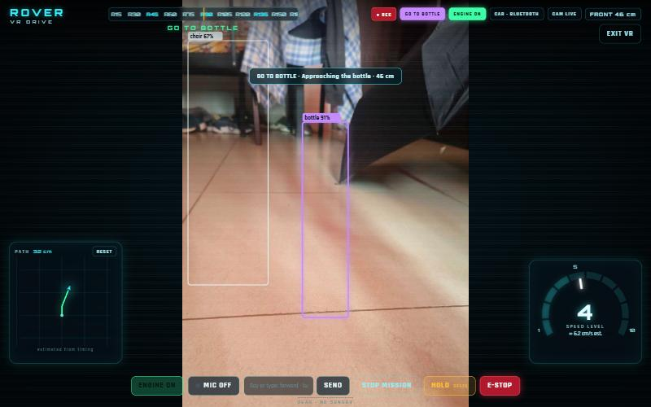
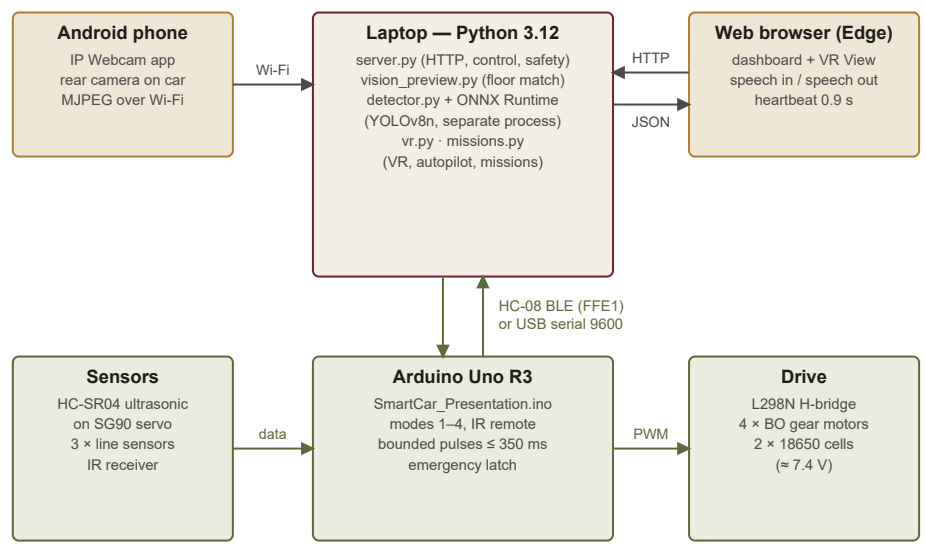
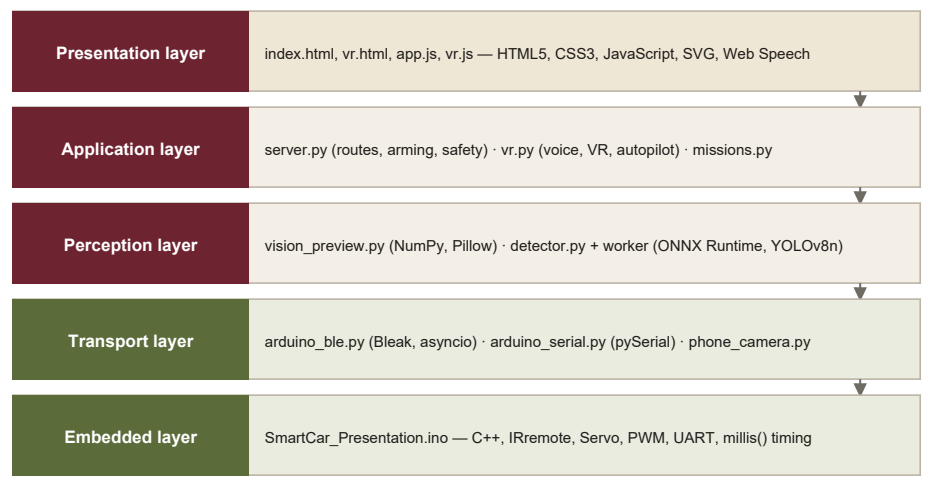
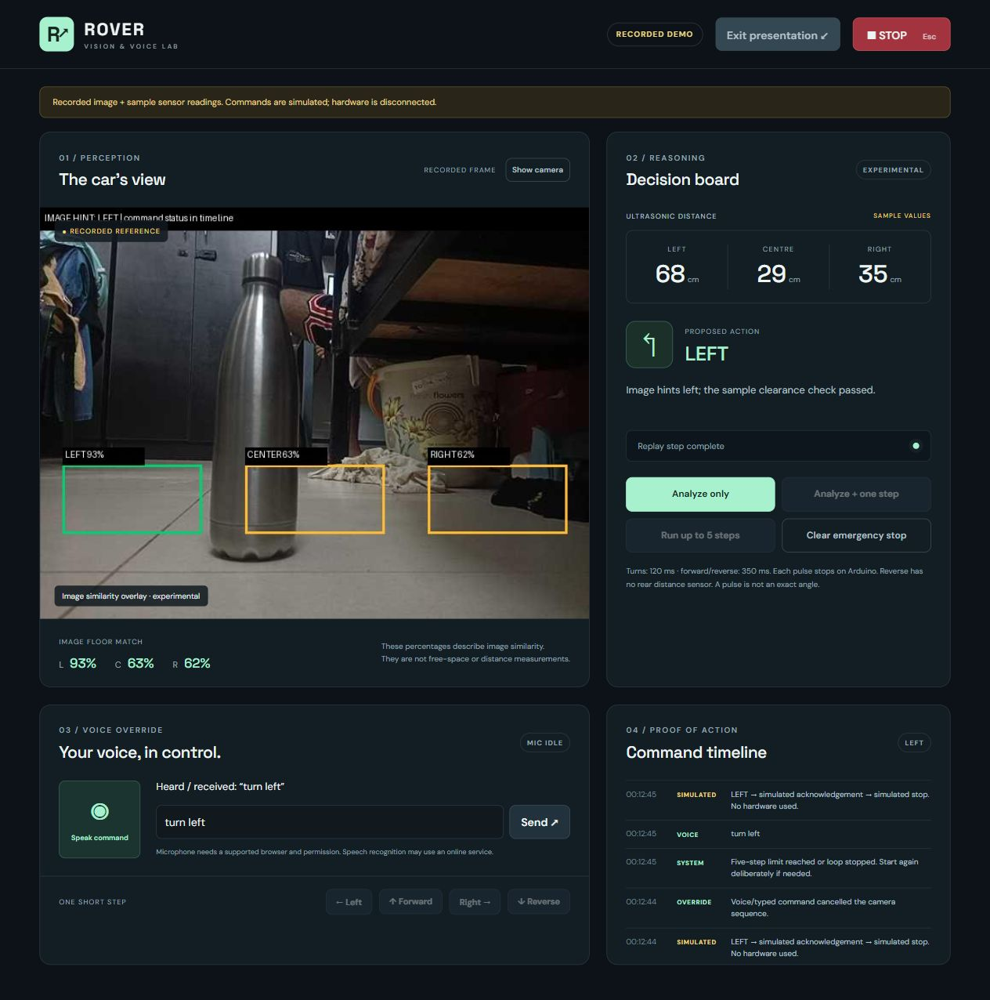
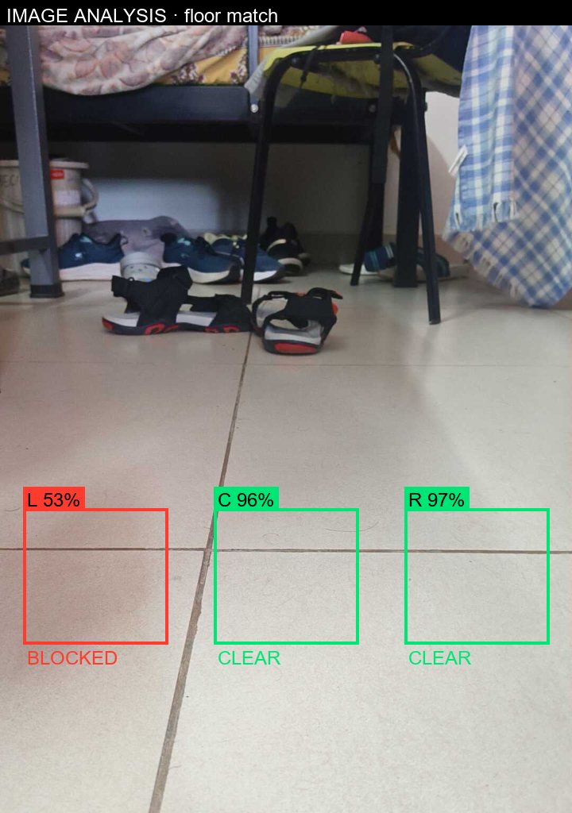
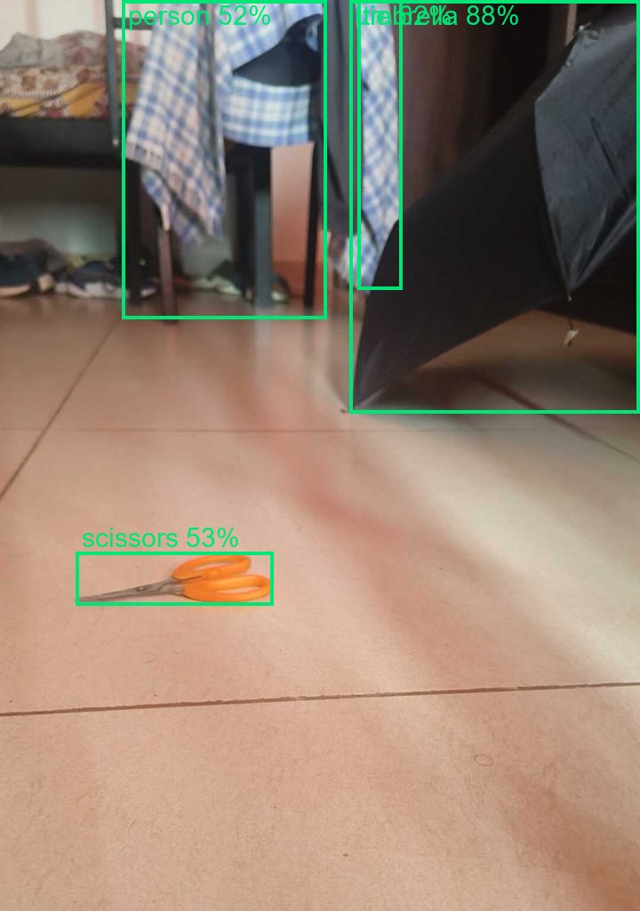

# ROVER — Multi-Mode Arduino Car with Voice Control, Object Recognition and Shared-Control Autonomy

A low-cost Arduino robot car that you can drive with an **IR remote**, your **voice**, typed **routes** or an immersive full-screen **VR-style camera view** — and that can carry out simple autonomous tasks (go to a target, go around obstacles, follow a person, repeat a taught route, return home) while you supervise and correct it by voice.

A phone mounted on the car is its **eyes**, a laptop running Python is its **brain**, and the Arduino only drives the motors and reads the sensors.

<p align="center">
  
</p>

> Course project — **Embedded Systems (BCSE305L)**, B.Tech Computer Science and Engineering. Full report: [`docs/ROVER-Project-Report.pdf`](docs/ROVER-Project-Report.pdf).

---

## Highlights

- **Voice driving** — “turn right 30 degrees and move forward”, “speed level 3”, “stop”. Strict, fully tested grammar: an unknown phrase never moves the car.
- **Object recognition** — pre-trained **YOLOv8-nano** run with **ONNX Runtime** on the laptop CPU (≈ 35–60 ms per frame); “go to the umbrella”, “come to me”, “what do you see?” with spoken answers.
- **Shared-control autopilot** — “autopilot 200 cm” drives to a point, avoids obstacles, remembers where they were, and accepts corrections such as “dodge left”, “hold”, “resume”. When stuck it asks for help instead of guessing.
- **Teach-and-repeat and go home** — record a route by driving it, replay it later, or retrace the path back to the start.
- **Follow me** — keeps a person centred and 50–90 cm away.
- **VR View** — full-screen game-style HUD with directional danger glows, speed gauge (levels 1–10), heading compass, path minimap and environment reports.
- **Explainable vision** — a transparent floor-colour analysis shows its scores on screen; the ultrasonic sensor confirms every move.
- **Safety by design** — every movement the laptop requests is a pulse of at most 350 ms that the Arduino ends by itself, so a crash or lost Bluetooth link can never leave the car driving.

## Architecture

<p align="center"></p>
<p align="center"></p>

## Tech stack

| Layer | Technologies |
|---|---|
| Embedded | C++ (Arduino), Arduino Uno R3, IRremote, Servo, PWM, UART, L298N, HC-SR04, HC-08 BLE |
| Backend | Python 3.12, `http.server`, `threading`, `asyncio`, regular-expression grammar |
| Vision / AI | NumPy, Pillow, YOLOv8-nano (COCO, pre-trained), ONNX Runtime, Depth Anything V2 (experiment) |
| Communication | Bluetooth Low Energy (Bleak), USB serial (pySerial), MJPEG over Wi-Fi (IP Webcam) |
| Frontend | HTML5, CSS3, JavaScript, SVG, Web Speech API (recognition + synthesis), Fullscreen API |
| Testing | `unittest` + simulated car, sonar and detector — **97 tests** |

## How it works (in brief)

1. **Voice → actions.** The browser’s Web Speech API turns speech into text; Python normalises it (“forty five” → 45), splits clauses on “and/then” and matches each against a strict grammar.
2. **Floor analysis.** Each frame is cropped, resized to 300×240 and split into left/centre/right; pixels a little ahead are compared with the floor colour just in front of the car (median RGB, distance < 65). ≥ 70 % similar → clear.
3. **Object detection.** Frames are letterboxed to 640×640, run through YOLOv8n in ONNX Runtime, decoded (84×8400 output) and filtered with non-maximum suppression. Detection runs in a **separate process**, so a native crash can never stop the server.
4. **Autopilot.** Stop → look (fresh frame + one ultrasonic reading) → decide: turn 10° away from a blocked centre, keep 22 cm from remembered obstacles, steer back toward the destination, or drive ≤ 10 cm. Position is dead-reckoned from motor timing.
5. **Bounded pulses.** The laptop sends packets like `@F350`; the Arduino starts the motors, records the end time with `millis()` and stops them itself, replying `AI:ACK:F` then `AI:MOVE_DONE`.

## Screenshots

| Dashboard | Live floor analysis | Object detection (real camera) |
|---|---|---|
|  |  |  |

## Results

- **97 automated tests pass** (dashboard 29, Bluetooth 11, VR 15, missions 15, laptop helpers 27).
- Simulated autopilot around a bottle 40 cm ahead: closest approach ≈ 26 cm, widest deviation 35 cm, final error 0.7 cm from the line.
- Teach-and-repeat and go-home return within 8 cm in simulation.
- Real detection on the car camera: umbrella 88 %, scissors 53 %.

**Honest limitations:** positions come from timing (no encoders or gyro), the ultrasonic only looks forward, and the pre-trained detector does not recognise every object (it missed a steel flask). See chapter 10 of the report for the planned fixes, including fine-tuning the detector on the car’s own images.

## Getting started

**Hardware:** Arduino Uno R3 + Sensor Shield v5, L298N, 4 DC gear motors, 2×18650 cells, HC-SR04 on an SG90 servo, 3 line sensors, IR receiver + remote, HC-08 BLE module, an Android phone with the *IP Webcam* app.

```bash
# 1. Python packages (Python 3.10+)
pip install -r requirements.txt

# 2. Optional, for object detection: export YOLOv8n to ONNX (see models/README.md)

# 3. Upload SmartCar_Presentation/SmartCar_Presentation.ino with the Arduino IDE
#    (remove the HC-08 module while uploading — it shares the USB serial pins)

# 4. Start the dashboard
python smartcar_dashboard/server.py
# open http://127.0.0.1:8765 (VR View at /vr) in Edge or Chrome
```

Run the tests:

```bash
cd smartcar_dashboard && python -m unittest test_dashboard test_ble test_vr test_missions
```

Set your own HC-08 address in `smartcar_laptop/arduino_ble.py` (`ADDRESS`).

## Project structure

```
SmartCar_Presentation/   Arduino firmware (C++)
smartcar_dashboard/      server, VR View, autopilot, missions, detector, web UI, tests
smartcar_laptop/         Bluetooth / USB transports, camera stream, image analysis, tests
active_view_frames/      sample frame for the recorded-demo mode
models/                  place yolov8n.onnx here (not committed)
docs/                    project report and images
```

## Team

- **Mihir Bhati**
- **Ahana Sharan**
- **Archit Khandelwal**
- **Arnav Astu**

## Acknowledgements

- Object detection uses [Ultralytics YOLOv8](https://github.com/ultralytics/ultralytics) weights pre-trained on COCO (AGPL-3.0); the weights are **not** included in this repository.
- Depth experiment: [Depth Anything V2](https://github.com/DepthAnything/Depth-Anything-V2).
- Bluetooth: [Bleak](https://github.com/hbldh/bleak). IR decoding: [Arduino-IRremote](https://github.com/Arduino-IRremote/Arduino-IRremote).
